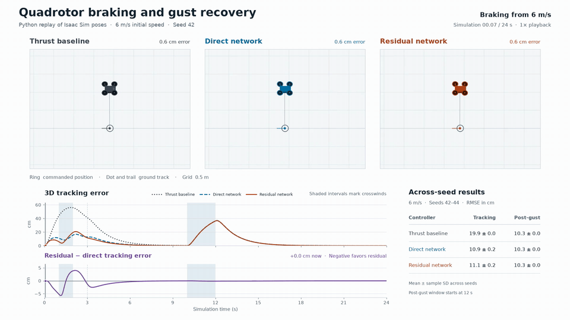

# Learning Corrections to Drone Motion Models

Emilio Sebastian Daza Vigo · 2026

Does adding a simple thrust model to a small neural network improve acceleration predictions on unseen quadrotor flights? This project compares five models on recorded NeuroBEM flights, then evaluates the two neural models in a separate Isaac Sim braking and crosswind benchmark.

## Isaac Sim demonstration

The replay compares thrust, direct neural, and residual neural controllers from a 6 m/s initial speed using seed 42. Isaac Sim/PhysX computed the motion, and Python renders the saved poses alongside synchronized tracking errors. The 13.2-second clip covers 24 seconds of simulation, with quiet intervals played at 4×. [Full-resolution MP4](presentation/media/drone_demo.mp4) · [Replay provenance](analysis/results/video_provenance.md)

## Results

The models predict three components of body-frame acceleration from body velocity, angular velocity, and squared rotor speeds. The direct network predicts acceleration in one step. The residual network predicts the error of a fitted thrust model and adds that correction to the thrust estimate.

| Test set | Thrust | Ordinary least squares | Ridge | Direct network | Residual network |
| --- | ---: | ---: | ---: | ---: | ---: |
| All speeds | 1.7365 | 0.8783 | 0.9193 | 0.4985 | **0.4906** |
| Below 5 m/s | 0.4955 | 0.4349 | 0.4245 | **0.3322** | 0.3369 |
| At least 5 m/s | 2.7854 | 1.3299 | 1.4083 | 0.6963 | **0.6772** |

Acceleration RMSE is in m/s². The neural scores are means across three training seeds. At 5 m/s and above, the residual network reduces pooled RMSE by 2.7% relative to the direct network and improves RMSE on 10 of 12 eligible flights in an exploratory paired comparison. [Overall results and seed variation](analysis/results/test_metrics.csv) · [Speed groups](analysis/results/metrics_by_speed.csv) · [Paired flight scores](analysis/results/paired_high_speed_flights.csv)

In Isaac Sim, with an initial speed of 6 m/s, full-trial position tracking RMSE averaged 19.89 cm for thrust, 10.85 cm for the direct network, and 11.10 cm for the residual network. The benchmark uses a shared drag model and applies neural corrections laterally. These results characterize the simulated controllers under those assumptions. [Simulation results](analysis/results/simulation_aggregate.csv) · [Trajectory and pose logs](isaac-11043212/flight/)

## Code and dataset

The University of Zurich Robotics and Perception Group's processed NeuroBEM release supplies the real-flight data. All segments of each original flight stay together. The project holds out every flight represented in the authors' test list and splits the rest into training and validation sets. There are 65 training, 17 validation, and 13 test flights. [Dataset documentation](https://rpg.ifi.uzh.ch/neuro_bem/Readme.html) · [Processed archive, 657 MB](https://download.ifi.uzh.ch/rpg/NeuroBEM/processed_data.zip) · [Authors' test list](https://download.ifi.uzh.ch/rpg/NeuroBEM/testset.txt) · [Exact project splits](analysis/results/flight_splits.csv)

The simplified thrust model draws on the hybrid modeling approach of Leonard Bauersfeld, Elia Kaufmann, Philipp Foehn, Sihao Sun, and Davide Scaramuzza in *NeuroBEM: Hybrid Aerodynamic Quadrotor Model*, Robotics: Science and Systems, 2021. The comparison here uses one fitted thrust coefficient and a 32-unit hidden layer. [NeuroBEM paper, DOI 10.15607/RSS.2021.XVII.042](https://doi.org/10.15607/RSS.2021.XVII.042) · [Training and evaluation code](Learning%20Corrections%20to%20Drone%20Models.ipynb) · [Isaac Sim code](quadrotor_showcase/)

## Reproduce the comparison

Start with the executed notebook to inspect the split, training, and evaluation. To check the reported scores without retraining the neural networks, download the official archive and test list and run the checkpoint verification steps in the reproduction guide. The checkpoint includes the neural weights, input scaler, and fitted thrust coefficient. The guide also provides input checksums and instructions for regenerating figures. [Notebook](Learning%20Corrections%20to%20Drone%20Models.ipynb) · [Checkpoint](neurobem_dynamics.npz) · [Reproduction guide](analysis/README.md)

The saved simulation scores can be recomputed locally with NumPy by running `python analysis/verify_simulation.py --repo .` from the repository root. A fresh physics run uses the Isaac Sim source and requires an Isaac Sim environment. [Verification script](analysis/verify_simulation.py) · [Isaac Sim source](quadrotor_showcase/)

## Report and presentation

The report describes model selection, per-axis errors, flight-level diagnostics, and limits of the simulated control comparison. Run `bash build.sh` with TeX Live to rebuild both PDFs. [Report PDF](report/report.pdf) · [Report source and figures](report/) · [Presentation PDF](presentation/slides.pdf) · [Beamer source and media](presentation/)

## License and citation

The original project software and documentation are released under the MIT License. Obtain the NeuroBEM measurements from the University of Zurich under the dataset provider's terms. Cite both this project and the NeuroBEM paper when using the code and data together. [MIT License](LICENSE) · [Software citation](CITATION.cff)
